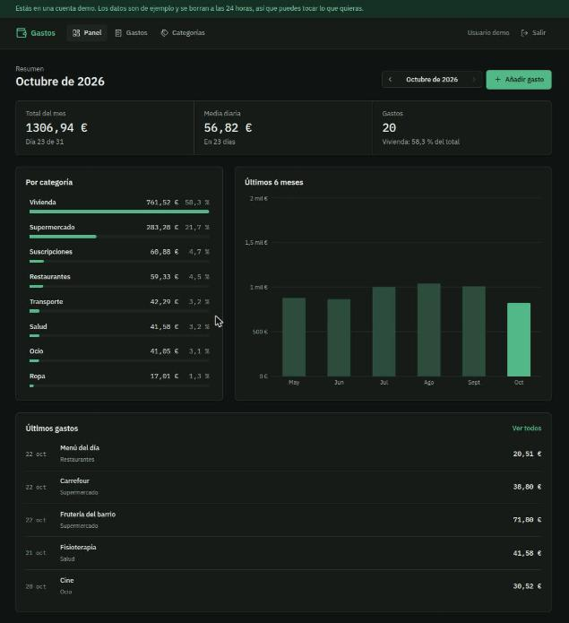
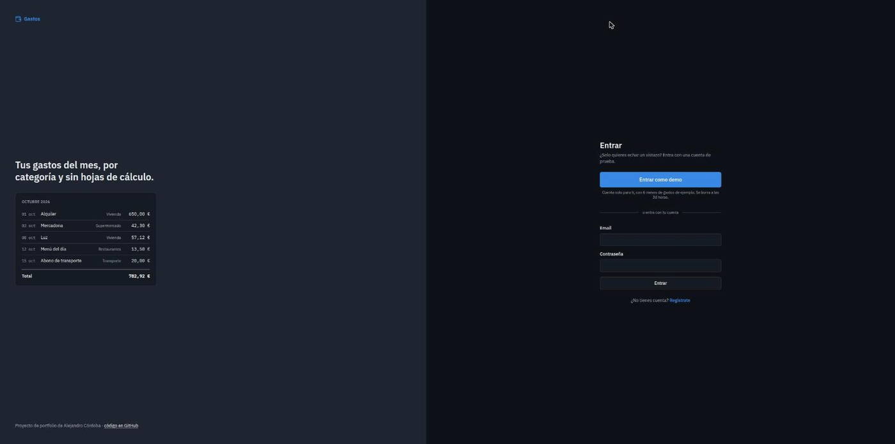
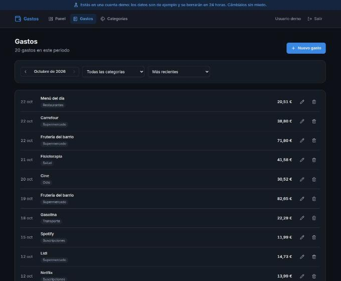

# Expense Tracker · Web

[](https://github.com/SEDEBE/expense-tracker-web/actions/workflows/ci.yml)


React frontend for my [Expense Tracker API](https://github.com/SEDEBE/expense-tracker-api) (Django
REST Framework): record expenses by category, see where your money goes each month and how it
changes over time. The interface is in Spanish.

**Try it without signing up:** the "Entrar como demo" button creates a private demo account
with six months of sample data, deleted after 24 hours.



| Login with the demo button | Expenses with filters |
|---|---|
|  |  |

## Features

- **Dashboard**: month total, daily average, top category, spending by category and a
  six-month chart. Click a category to see its expenses, or a column to open that month.
- **Expenses**: filter by month and category, sort by date or amount, paginate, create, edit
  and delete (with confirmation). Amounts accept a decimal comma (`12,50`).
- **Categories**: create, rename and delete (their expenses become uncategorized).
- **Auth**: register, log in, log out, "Continuar con Google" and one-click demo accounts.
  Password fields can be shown while typing. JWT access tokens renew automatically with the
  refresh token.
- Filters and the selected month live in the URL, so reloading or sharing a link keeps them.
- Light and dark mode (follows the OS), responsive layout, accessible forms and charts
  (labels, keyboard support, a screen-reader table behind the chart).

## Tech stack

| Area | Tools |
|---|---|
| UI | React 19, TypeScript (strict), Tailwind CSS 4, lucide icons |
| Data | TanStack Query (server state, cache, invalidation), a small typed `fetch` client |
| Routing | React Router (lazy-loaded pages) |
| Forms | React Hook Form + Zod (one schema for validation and types) |
| Charts | Recharts |
| Tests | Vitest, Testing Library, MSW (mocked API) |
| Quality | oxlint, `tsc` in CI |
| DevOps | Docker (multi-stage build served by Nginx), GitHub Actions |

## Quick start

Requires Node 24 (see `.nvmrc`) and the API running on `localhost:8000`
(`docker compose up` in [expense-tracker-api](https://github.com/SEDEBE/expense-tracker-api)).

```bash
git clone https://github.com/SEDEBE/expense-tracker-web.git
cd expense-tracker-web
npm ci
npm run dev        # http://localhost:5173
```

Other scripts:

```bash
npm run test       # tests in watch mode (npm run test:run for a single run)
npm run lint       # oxlint
npm run typecheck  # tsc
npm run build      # production build in dist/
```

With Docker, `docker compose up --build` serves the production build on
http://localhost:8080, also against the API on `localhost:8000`.

## How it works

- **One origin, no CORS in practice.** The app calls `/api/v1/...` on its own origin. In
  development Vite proxies `/api` to Django; in Docker and production Nginx (or Caddy in front)
  does the same. `VITE_API_URL` can point somewhere else if needed.
- **Server state is not copied into React state.** Every API read is a TanStack Query query;
  mutations invalidate the queries they affect (saving an expense refreshes the list, the
  monthly summary and the history chart).
- **Tokens**: the access/refresh pair is stored in `localStorage`. A `401` triggers a single
  refresh shared by all the requests that failed at the same time; if the refresh fails too,
  the session ends and the app goes back to the login page. (An httpOnly cookie would protect
  the tokens from XSS better; it needs CSRF handling on the API and is a possible next step.)
- **Google sign-in**: Google's own button (Google Identity Services) returns a signed ID token;
  the app sends it to `POST /api/v1/auth/google/`, which verifies it and returns the usual JWT
  pair. The button only appears when `VITE_GOOGLE_CLIENT_ID` is set (`.env.local` in
  development, `.env.production` for builds); the client ID is public, not a secret.
- **Errors in Spanish**: requests send `Accept-Language: es`, so the API's validation messages
  arrive translated and are shown next to each field.
- **Tests render the whole app** with an in-memory router and MSW answering the API calls, and
  check what the user sees (roles, labels, text), not implementation details.

## Project structure

```
src/
  app/          router, layout of logged-in pages, TanStack Query client
  components/   UI building blocks (buttons, fields, modal, month picker)
  features/
    auth/       login, register, demo login, session hooks
    dashboard/  stat tiles, category breakdown, history chart
    expenses/   list, filters, form
    categories/ list and inline rename
  lib/          API client, session store, Spanish formatting, types
  test/         MSW server and render helper
```
